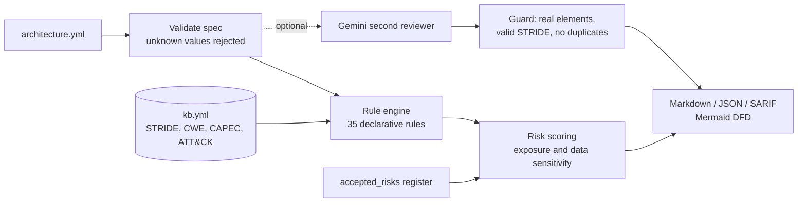

# ThreatLens

**Threat modeling as code for device platforms.** Describe a system's trust zones,
components and data flows in YAML. ThreatLens draws the data-flow diagram, runs a
35-rule STRIDE knowledge base aimed at the three things design reviews keep missing
(**access**, **abuse** of working features, and **logging**), scores each threat, and
writes a Markdown review and SARIF for GitHub code scanning. Gemini can act as a second
reviewer, behind a guard that rejects invented elements and duplicate findings.

**Live demo (runs in your browser): https://nags-gk.github.io/threatlens/** ·
[Benchmark](docs/benchmark.md) · [Threat catalog](docs/catalog.md) · [Spec reference](docs/spec-reference.md)

[](https://github.com/Nags-gk/threatlens/actions/workflows/ci.yml)

## What it found in real systems

I modeled two of my own deployed projects from their source and reviewed them.

**[FleetOps](https://github.com/Nags-gk/fleetops)** (serverless robot telemetry on AWS), from
`infra/lib/fleetops-stack.ts`: [full review](results/reviews/fleetops_as_built.md)

| Rating | Finding | Evidence in the code |
|---|---|---|
| Critical | `POST /incidents/{id}/resolve` and `/triage` have no caller authentication or authorization | the query routes are added with no authorizer |
| Critical | Every robot shares one `x-fleet-key` | `INGEST_KEY` stack prop; the README lists it as a known limitation |
| High | The shared key and an optional Gemini key sit in Lambda environment variables | `environment: { INGEST_KEY: ... }` |
| High | No security detection on API abuse; only operational alarms | four CloudWatch alarms, all operational |
| Medium | Logs kept 14 days, too short to investigate slow abuse | `logRetention: TWO_WEEKS` |

The first finding means anyone who learns the API URL can close incidents and silence
on-call. The fix is an authorizer on the write routes and per-device credentials (AWS
IoT Core with X.509) for robots.

**[AbuseRadar](https://github.com/Nags-gk/abuseradar)** API (Cloud Run): one accepted
risk (public read-only demo) and two open medium findings: Gemini is called with an API
key rather than workload identity, and Cloud Logging's default 30-day retention.

## Seeded-flaw benchmark

Four hardened reference architectures (smart home, wearable health sync, managed-device
enrollment, mobile carrier eSIM) produce zero findings. 33 mutation operators inject one
realistic flaw at a time (plaintext hop, missing MFA, shared device secret, SIM-swap
without step-up, recovery without re-authentication, deleted detection pipeline...),
giving 174 cases.

| Reviewer | Flaws found on the right element | Findings on clean baselines |
|---|---:|---:|
| Rule engine | **174 / 174** | **0** |
| Gemini 3.5 Flash alone | see [docs/benchmark.md](docs/benchmark.md) | |

The first run found 170/174: the knowledge base did not treat security logs as
sensitive data. That gap is fixed and now guarded in CI. Caveat: one author wrote both
the rules and the mutations, so this is a regression suite rather than proof of
real-world recall ([details](docs/benchmark.md#what-the-numbers-do-and-do-not-show)).

## Use it

```bash
pip install -e .            # pyyaml only; add .[llm] for Gemini
threatlens review examples/smart_home_cloud.yml                 # Markdown review with Mermaid DFD
threatlens review my-system.yml --format sarif --out review.sarif
threatlens review my-system.yml --fail-on high                  # CI gate: exit 1 on open high/critical
GEMINI_API_KEY=... threatlens review my-system.yml --llm        # add guarded Gemini suggestions
threatlens bench                                                # seeded-flaw benchmark
```

As a pull-request check that posts findings to code scanning:

```yaml
- uses: Nags-gk/threatlens@main
  with:
    spec: docs/architecture.yml
    fail-on: high
```

## How it works



* **Declarative rules.** Each rule in `threatlens/kb.yml` is data (`when` predicates
  such as `crosses_boundary`, `handles_any`, `lacks`), so the engine has no `eval` and
  the knowledge base is reviewable by people who do not read Python. Every rule names
  its CWE and, where one fits, CAPEC and ATT&CK technique.
* **Context-aware scoring.** Likelihood rises for internet-exposed elements, impact for
  credentials, health, location, payment, secrets or video.
* **Risk register.** `accepted_risks` keeps a justified exception visible in every
  review without failing the build.
* **Same code everywhere.** The browser demo loads the identical Python engine through
  Pyodide; no server is involved.

## Layout

```
threatlens/  model.py (spec + validation) engine.py kb.yml report.py (DFD, Markdown, SARIF) llm.py bench.py cli.py
examples/    four hardened reference architectures; real/ = my own systems modeled from source
results/     benchmark output and the reviews of the real systems
docs/        benchmark, catalog (generated), spec reference
web/         Pyodide demo for GitHub Pages
action.yml   reusable GitHub Action
```

## Limitations
* A spec describes intended design; ThreatLens cannot see drift between the spec and
  the deployed system. The FleetOps review was modeled from the CDK source to narrow that gap.
* Rules catch known patterns. Business-logic abuse specific to one product still needs a
  human (or the LLM pass, whose suggestions are guarded but not verified).

## License
MIT
