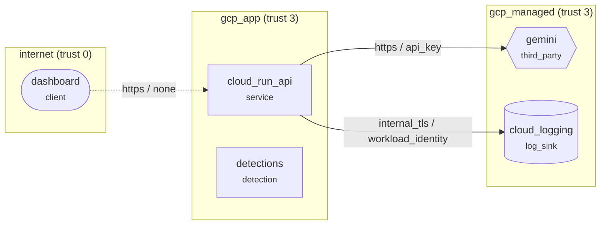

# Security design review: AbuseRadar API (as built)

Public FastAPI demo on Cloud Run (github.com/Nags-gk/abuseradar) serving incidents, scoring and Gemini triage to a GitHub Pages dashboard.

**Open findings:** 2 (2 medium) · **Accepted risks:** 1

## Data-flow diagram

Dashed edges are plaintext or unauthenticated hops; red components carry open high or critical findings.

## Findings

| Risk | Rating | ID | Element | STRIDE | Lens | Finding |
|---:|---|---|---|---|---|---|
| 6 | medium | TL-L03 | `cloud_logging` | Repudiation | logging | Log retention too short for investigations |
| 6 | medium | TL-S05 | `f_llm` | Spoofing | access | Service-to-service call uses a static API key |

## Recommended changes: access

- **TL-S05 on `f_llm` (medium).** Long-lived shared keys leak through logs, configs and laptops and rarely get rotated. **Change:** Use workload identity or mTLS with short-lived certificates between services. _(CWE-798 Use of Hard-coded Credentials)_

## Recommended changes: logging

- **TL-L03 on `cloud_logging` (medium).** Slow campaigns and late-reported takeovers fall outside the retention window, so impact cannot be measured. **Change:** Keep security logs at least 90 days hot and 1 year cold, subject to privacy review. _(CWE-779 Logging of Excessive Data)_

## Accepted risks

- TL-S01 on `f_dash`: Unauthenticated flow crosses a trust boundary. Justification: Public read-only demo over synthetic data; write-like endpoints are rate-limited and the triage budget is capped per day.
