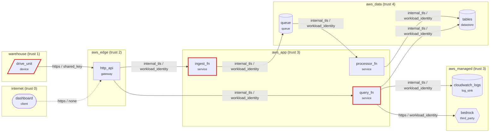

# Security design review: FleetOps (as built, commit 4926f67)

Serverless robot-fleet telemetry on AWS (github.com/Nags-gk/fleetops), modeled from infra/lib/fleetops-stack.ts. Robots post heartbeats with a shared x-fleet-key; a public HTTP API serves the dashboard and on-call triage.

**Open findings:** 13 (3 critical, 6 high, 4 medium) · **Accepted risks:** 1

## Data-flow diagram

Dashed edges are plaintext or unauthenticated hops; red components carry open high or critical findings.

## Findings

| Risk | Rating | ID | Element | STRIDE | Lens | Finding |
|---:|---|---|---|---|---|---|
| 20 | critical | TL-E04 | `query_fn` | Elevation of privilege | access | Missing object-level authorization |
| 20 | critical | TL-S01 | `f_dash_read` | Spoofing | access | Unauthenticated flow crosses a trust boundary |
| 20 | critical | TL-S03 | `drive_unit` | Spoofing | access | Devices share one fleet-wide credential |
| 15 | high | TL-I04 | `ingest_fn` | Information disclosure | data | Secrets stored outside a secret manager |
| 15 | high | TL-I04 | `query_fn` | Information disclosure | data | Secrets stored outside a secret manager |
| 12 | high | TL-L01 | `ingest_fn` | Repudiation | logging | Authentication events lack security logging fields |
| 12 | high | TL-L02 | `system` | Repudiation | logging | No detection consumes the security logs |
| 12 | high | TL-R01 | `query_fn` | Repudiation | logging | Sensitive actions are not audit-logged |
| 12 | high | TL-S04 | `drive_unit` | Spoofing | access | Device credential is not bound to hardware |
| 8 | medium | TL-A10 | `drive_unit` | Spoofing | access | Long-lived device or API keys are never rotated |
| 8 | medium | TL-D02 | `ingest_fn` | Denial of service | abuse | Device check-in without per-device rate limits |
| 6 | medium | TL-L03 | `cloudwatch_logs` | Repudiation | logging | Log retention too short for investigations |
| 6 | medium | TL-L04 | `cloudwatch_logs` | Repudiation | logging | Logs are not tamper-evident |

## Recommended changes: access

- **TL-E04 on `query_fn` (critical).** An authenticated user requests another user's objects by changing an ID (IDOR). **Change:** Check ownership of every object on every request in the service, not in the client. _(CWE-862 Missing Authorization · CAPEC-122 Privilege Abuse)_
- **TL-S01 on `f_dash_read` (critical).** Anything that can reach the receiving side can send requests as any caller, because nothing proves who the sender is. **Change:** Authenticate the flow (OAuth 2.0 for users, mTLS or workload identity for services, per-device certificates for devices) and reject unauthenticated requests at the boundary. _(CWE-306 Missing Authentication for Critical Function · CAPEC-115 Authentication Bypass)_
- **TL-S03 on `drive_unit` (critical).** Extracting the secret from one device lets an attacker impersonate every device in the fleet. **Change:** Provision a unique per-device credential at manufacture and support revoking a single device. _(CWE-798 Use of Hard-coded Credentials · CAPEC-191 Read Sensitive Constants Within an Executable)_
- **TL-S04 on `drive_unit` (high).** A credential copied off the device can be replayed from a server, cloning the device identity. **Change:** Keep device keys in a secure element and verify key attestation at check-in; alert on one identity seen from two networks. _(CWE-522 Insufficiently Protected Credentials · T1036 Masquerading)_
- **TL-A10 on `drive_unit` (medium).** A key leaked years ago still works. **Change:** Rotate keys on a schedule and on every suspected compromise; keep validity short. _(CWE-324 Use of a Key Past its Expiration Date)_

## Recommended changes: abuse

- **TL-D02 on `ingest_fn` (medium).** A cloned or buggy device floods check-ins and drowns the signal for the rest of the fleet. **Change:** Limit check-ins per device identity and alert when one identity exceeds its cadence. _(CWE-770 Allocation of Resources Without Limits or Throttling)_

## Recommended changes: logging

- **TL-L01 on `ingest_fn` (high).** Without source IP, ASN, device fingerprint and result on each attempt, stuffing, spraying and takeovers cannot be detected or scoped. **Change:** Log every attempt with timestamp, account, IP, ASN, device fingerprint, user agent, result, and a keyed hash of the attempted secret. _(CWE-223 Omission of Security-relevant Information)_
- **TL-L02 on `system` (high).** Logs are written but nobody is alerted; abuse is found by users or the press. **Change:** Stream security logs to a detection pipeline with rules for the abuse cases in this model and an on-call rotation. _(CWE-778 Insufficient Logging)_
- **TL-R01 on `query_fn` (high).** After an incident nobody can say who did what, when, and from where. **Change:** Write an append-only audit record (actor, action, target, time, source IP, device) for every sensitive action. _(CWE-778 Insufficient Logging)_
- **TL-L03 on `cloudwatch_logs` (medium).** Slow campaigns and late-reported takeovers fall outside the retention window, so impact cannot be measured. **Change:** Keep security logs at least 90 days hot and 1 year cold, subject to privacy review. _(CWE-779 Logging of Excessive Data)_
- **TL-L04 on `cloudwatch_logs` (medium).** An attacker with write access can delete or edit the records of what they did. **Change:** Ship logs to a separate project with write-only access for producers and object retention locks. _(CWE-117 Improper Output Neutralization for Logs)_

## Recommended changes: data

- **TL-I04 on `ingest_fn` (high).** Keys in environment files and images leak through repositories, crash dumps and support bundles. **Change:** Load secrets at runtime from a secret manager with per-service access and rotation. _(CWE-312 Cleartext Storage of Sensitive Information)_
- **TL-I04 on `query_fn` (high).** Keys in environment files and images leak through repositories, crash dumps and support bundles. **Change:** Load secrets at runtime from a secret manager with per-service access and rotation. _(CWE-312 Cleartext Storage of Sensitive Information)_

## Accepted risks

- TL-T04 on `http_api`: Internet-facing service writes to a datastore without input validation. Justification: API Gateway passes requests through; IngestHandler and QueryHandler validate every field before use.
